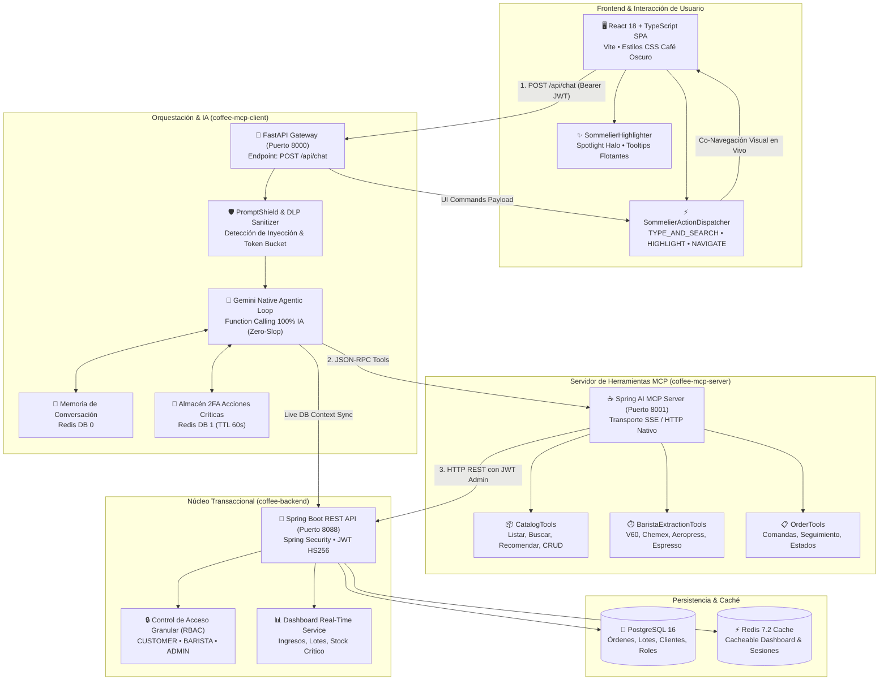

# ☕ Sistema Café — Tostaduría de Especialidad & Origen
### Plataforma Empresarial Full-Stack con Sommelier AI, Co-Navegación Visual y Arquitectura MCP

[](https://openjdk.org/)
[](https://spring.io/projects/spring-boot)
[](https://spring.io/projects/spring-ai)
[](https://fastapi.tiangolo.com/)
[](https://react.dev/)
[](https://www.docker.com/)
[](https://www.postgresql.org/)
[](https://redis.io/)

**Sistema Café** es una plataforma integral de comercio electrónico, gestión de tostaduría e inventario calibrado, diseñada con una arquitectura de microservicios distribuida y respaldada por **Sommelier AI**: un copiloto virtual inteligente que combina **Model Context Protocol (MCP)** con un motor de **Co-Navegación y Acciones Visuales en Tiempo Real**.

---

## 🏗️ Arquitectura del Sistema

La solución desacopla el razonamiento agéntico, la ejecución de herramientas deterministas y la persistencia de datos relacionales y en memoria:



---

## ✨ Características Principales

### 1. Copiloto Inteligente Sommelier AI con Co-Navegación
- **Function Calling Nativo de Google Gemini:** Cero respuestas plantilla prefabricadas. La IA evalúa las herramientas registradas, consulta la base de datos en vivo y genera respuestas fluidas en lenguaje natural con perfil sommelier barista.
- **Motor de Co-Navegación (`SommelierActionDispatcher`):** El asistente controla la interfaz en tiempo real frente al usuario:
  - `TYPE_AND_SEARCH`: Simula escritura automática en la barra de búsqueda de la tienda filtrando tarjetas al instante sin recargas.
  - `HIGHLIGHT_ELEMENT`: Enfoca productos o tarjetas en la pantalla con un halo animado (`SommelierHighlighter`) y etiqueta `Sommelier AI ✨`.
  - `NAVIGATE`: Conduce automáticamente al usuario hacia `/carritocliente`, `/my-orders`, `/catalog` o `/orders` ante expresiones cotidianas (ej. *"revisemos el pedido"*, *"quiero ver mi orden"*, *"mis compras"*).

### 2. Seguridad Zero-Trust & Doble Factor (2FA) en Redis
- **Autenticación sin Confianza en Cliente:** El frontend no envía roles ni identificadores en el cuerpo de la petición. Toda identidad se extrae y valida desde el token `Bearer <JWT>` firmado con algoritmo `HS256`.
- **Protección de Entrada y Salida:** Pipeline multicapa con `PromptShield` contra inyecciones de prompt, limitador de tasa Token Bucket y sanitización de salida `DataSanitizer` (DLP).
- **Confirmación en Dos Pasos (2FA) para Acciones Críticas:** Acciones destructivas (ej. reseteo total o eliminación masiva de cafés) quedan congeladas en `Redis DB 1` con una ventana de confirmación estricta de 60 segundos (`TTL: 60s`). Si el administrador confirma con la frase clave autorizada, la acción se ejecuta; de lo contrario, expira sin impacto.

### 3. Página Dedicada de Carrito y Checkout (`/carritocliente`)
- Se reemplazó el antiguo panel lateral (drawer) por una experiencia de compra completa y elegante.
- Desglose financiero exacto: subtotal por ítem, IVA discriminado, acumulación de puntos de fidelidad y formulario integrado de facturación y pago con tarjeta, transferencia o efectivo.

### 4. Matriz de Roles (RBAC) y Métricas Financieras Auditadas
- **Cliente (`ROLE_CUSTOMER`):** Catálogo de cafés de origen, carrito sincronizado, historial de compras propio y asesoría de compra personalizada.
- **Barista (`ROLE_BARISTA`):** Comandas de barra en tiempo real, cambio de estados (`PREPARING`, `READY`), fichas técnicas de extracción paramétricas (V60, Chemex, Aeropress, Espresso) y protección contra operaciones administrativas.
- **Administrador (`ROLE_ADMIN`):** Control total del catálogo (CRUD completo), consola de operaciones ejecutivas con KPIs financieros en tiempo real (ingresos acumulados, inventario crítico, clientes leales y distribución por nivel de tueste). Cero datos mockeados: cada número se calcula directamente sobre PostgreSQL.

---

## 🛠️ Stack Tecnológico

| Capa | Componente | Tecnologías Clave |
| :--- | :--- | :--- |
| **Frontend** | `coffee-frontend` | React 18, TypeScript, Vite, React Router v6, Context API, Lucide Icons, Nginx Alpine |
| **Orquestador MCP** | `coffee-mcp-client` | Python 3.12, FastAPI, Google Gemini API, Redis AsyncIO, PyJWT, Pydantic v2 |
| **Servidor MCP** | `coffee-mcp-server` | Java 17, Spring Boot 3.4.0, Spring AI WebFlux (SSE / HTTP), Jackson |
| **Backend Core** | `coffee-backend` | Java 17, Spring Boot 3.4.0, Spring Data JPA, Spring Security, Hibernate, HikariCP |
| **Base de Datos** | `coffee-postgres` | PostgreSQL 16 Alpine con índices B-Tree en SKU, estados y fechas |
| **Caché y 2FA** | `coffee-redis` | Redis 7.2 Alpine (`DB 0`: memoria conversacional / `DB 1`: almacén 2FA con TTL) |

---

## 🚀 Guía de Instalación y Despliegue con Docker Compose

### 1. Prerrequisitos
- **Docker Desktop** (v24.0+) o Docker Engine con Docker Compose v2.
- Una **API Key de Google Gemini** (gratuita en [Google AI Studio](https://aistudio.google.com/)).
- Git instalado.

### 2. Clonar el Repositorio
```bash
git clone https://github.com/J7pultra/CafeteriaSistema.git
cd CafeteriaSistema
```

### 3. Configurar Variables de Entorno
Copia el archivo de plantilla `.env.example` a `.env`:
```bash
cp .env.example .env
```
Edita `.env` y coloca tu clave de Gemini:
```env
GEMINI_API_KEY=tu_api_key_real_de_gemini_aqui
GEMINI_MODEL=gemini-flash-lite-latest
```

### 4. Construir y Levantar los 6 Contenedores
Ejecuta el despliegue orquestado:
```bash
docker-compose up -d --build
```

### 5. Verificar la Salud de los Servicios
Comprueba que los 6 contenedores estén levantados y en estado `healthy`:
```bash
docker-compose ps
```

Salida esperada:
```
NAME                IMAGE                              STATUS
coffee-postgres     postgres:16-alpine                 Up (healthy)
coffee-redis        redis:7.2-alpine                   Up (healthy)
coffee-backend      coffee-enterprise-backend:1.0.0    Up (healthy)
coffee-mcp-server   coffee-mcp-server:1.0.0            Up (healthy)
coffee-mcp-client   coffee-mcp-client:1.0.0            Up (healthy)
coffee-frontend     coffee-enterprise-frontend:1.0.0   Up (healthy)
```

---

## 🌐 Puertos de Acceso y Credenciales de Prueba

| Servicio | URL Local | Descripción |
| :--- | :--- | :--- |
| **Tienda & Consola Web** | [http://localhost:3000](http://localhost:3000) | Aplicación React principal |
| **API REST Backend** | [http://localhost:8088/swagger-ui.html](http://localhost:8088/swagger-ui.html) | Documentación OpenAPI / Swagger |
| **Servicio Agente MCP** | [http://localhost:8000/docs](http://localhost:8000/docs) | Swagger del Cliente MCP FastAPI |
| **Servidor Spring AI MCP** | [http://localhost:8001/mcp/sse](http://localhost:8001/mcp/sse) | Endpoint SSE de Herramientas MCP |

### Credenciales Preconfiguradas (DataInitializer):

| Rol | Usuario | Contraseña | Permisos Principales |
| :--- | :--- | :--- | :--- |
| **Administrador** | `admin` | `admin123` | Dashboard de ingresos, CRUD de catálogo, reset con 2FA |
| **Barista** | `barista` | `barista123` | Comandas de barra, recetas de extracción, despacho |
| **Cliente** | `cliente_carlos` | `cliente123` | Catálogo de especialidad, carrito, checkout `/carritocliente` |

---

## 📸 Galería de Certificación y Evidencias Visuales

Las pruebas end-to-end automatizadas con el servidor Playwright MCP certificaron el 100% de los flujos de negocio:

| Escenario de Certificación | Descripción de la Prueba | Evidencia Visual |
| :--- | :--- | :---: |
| **1. Búsqueda Visual** | Simulación de escritura automática en tiempo real filtrando cafés con notas a chocolate. | [Ver Captura](docs/screenshots/escenario1_busqueda_visual.png) |
| **2. Carrito Sincronizado** | Adición exacta de 1 unidad con resalte Spotlight y cero drawers intrusivos. | [Ver Captura](docs/screenshots/escenario2_carrito_sincronizado.png) |
| **3. Checkout Dedicado** | Navegación automática a `/carritocliente`, facturación exitosa y vaciado del carrito. | [Ver Captura](docs/screenshots/escenario3_facturacion_exitosa.png) |
| **4. Mis Pedidos** | Co-navegación directa a `/my-orders` mostrando las órdenes confirmadas del cliente. | [Ver Captura](docs/screenshots/escenario4_mis_pedidos.png) |
| **5. Bloqueo Zero-Trust** | Rechazo determinista ante intentos de clientes de eliminar lotes del catálogo. | [Ver Captura](docs/screenshots/escenario5_rbac_bloqueo.png) |
| **6. 2FA en Redis** | Ventana de confirmación de 60 segundos antes de ejecutar reseteos masivos del catálogo. | [Ver Captura](docs/screenshots/escenario6_2fa_confirmacion.png) |
| **7. CRUD de Productos** | Creación, actualización de precio/stock y desactivación de lotes en PostgreSQL. | [Ver Captura](docs/screenshots/fase2_crud_update.png) |
| **8. Cuadre de Métricas** | Ingresos del Dashboard coincidiendo al centavo con la base de datos (\$29.68). | [Ver Captura](docs/screenshots/fase4_metricas_actualizadas.png) |

---

## 📄 Licencia y Autores

Desarrollado para **Sistema Café** bajo estándares empresariales de arquitectura Full-Stack, inteligencia artificial con Function Calling y seguridad Zero-Trust.  
Todos los derechos reservados © 2026.
